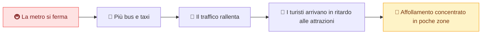
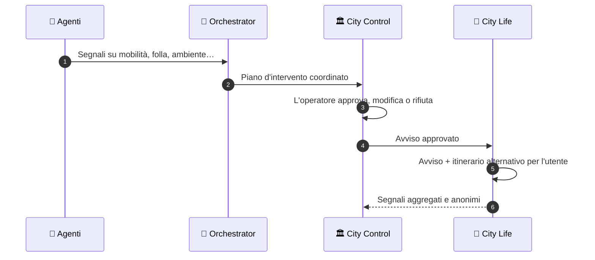
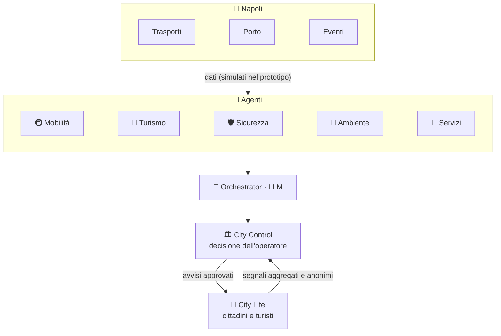

<div align="center">


### 🌋 Un ecosistema di agenti intelligenti che trasforma Napoli in una città capace di **prevedere i problemi**, **coordinare i servizi** e **reagire in tempo reale**.

<br/>


<br/>

[**Il progetto**](#-il-progetto) ·
[**City Control**](#%EF%B8%8F-city-control) ·
[**City Life**](#-city-life) ·
[**Architettura**](#-architettura) ·
[**Avvio**](#-avvio-rapido) ·
[**Team**](#-il-team)

</div>

---

## 🎯 Il progetto

Napoli è una delle mete turistiche più visitate d'Italia, e in certe giornate deve gestire **tutto insieme**: due navi da crociera in porto, una partita allo stadio, un evento sul lungomare e, magari, un guasto alla metropolitana.

Il problema non è solo il numero di persone: è l'**effetto domino**.



La nostra idea è un **sistema di agenti AI che collaborano**: ciascuno si occupa di un servizio, e un **agente orchestratore** li coordina e propone soluzioni quando la situazione cambia.

<table>
<tr>
<td width="50%" valign="top">

### 🏛️ City Control
**Per il Comune e la sala operativa.**

Aiuta a prendere decisioni coordinate **in pochi minuti**.

</td>
<td width="50%" valign="top">

### 📱 City Life
**Per cittadini e turisti.**

Li aiuta a trovare percorsi, servizi e alternative **in tempo reale**.

</td>
</tr>
</table>

### 🤖 Gli agenti

| | Agente | Di cosa si occupa |
|:-:|---|---|
| 🚇 | **Mobilità** | Trasporto pubblico, traffico, percorsi |
| 🧭 | **Turismo** | Flussi di visitatori, attrazioni, itinerari |
| 🛡️ | **Sicurezza** | Affollamento, eventi, presidio del territorio |
| 🌿 | **Ambiente** | Qualità dell'aria e condizioni ambientali |
| 🏢 | **Servizi pubblici** | Servizi al cittadino e al visitatore |
| 🧠 | **Orchestrator** | Coordina tutti gli agenti e propone piani d'intervento |

---

## ✅ Cosa abbiamo fatto

Abbiamo realizzato un **prototipo dimostrativo** delle due applicazioni, che mostra come un'informazione prodotta dagli agenti diventi **una decisione per il Comune** e, subito dopo, **un avviso utile per chi si trova in città**.

> [!NOTE]
> **Lo scenario del prototipo:** un sabato con crocieristi e partita, mentre la **Linea 1** della metropolitana si guasta.



---

## 🏛️ City Control

> **La plancia di comando dell'operatore comunale.**

<table>
<tr>
<td width="64" align="center">🗺️</td>
<td><b>1 · Vedere la città</b><br/>Una mappa delle zone principali — <i>Piazza del Plebiscito, Porto, Centro storico, Garibaldi, Lungomare, Vomero, Fuorigrotta</i> — con il loro stato (🟢 regolare · 🟡 attenzione · 🔴 critico), l'affollamento e il traffico.</td>
</tr>
<tr>
<td align="center">🤖</td>
<td><b>2 · Seguire gli agenti</b><br/>I cinque agenti (Mobilità, Turismo, Sicurezza, Ambiente, Servizi pubblici) mostrano su cosa stanno lavorando.</td>
</tr>
<tr>
<td align="center">✅</td>
<td><b>3 · Decidere sui piani</b><br/>L'Orchestrator propone piani d'intervento coordinati e l'operatore li <b>approva, li modifica o li rifiuta</b>. <b>La decisione finale spetta sempre a una persona.</b></td>
</tr>
<tr>
<td align="center">🧪</td>
<td><b>4 · Simulare scenari (What-If)</b><br/>L'operatore descrive una situazione, per esempio <i>"la metro resta ferma altre due ore"</i>, e il sistema indica le zone a rischio, gli effetti su ogni agente, un piano consigliato e una bozza di avviso per i cittadini.</td>
</tr>
<tr>
<td align="center">🔗</td>
<td><b>5 · Collegarsi a City Life</b><br/>Gli avvisi approvati vengono pubblicati su City Life, e l'operatore vede <b>segnali aggregati e anonimi</b>, senza dati individuali.</td>
</tr>
</table>

**Sezioni dell'app:** `Mappa e Flussi` · `Piani Orchestrator` · `Simulatore What-If` · `Ponte City Life`

---

## 📱 City Life

> **L'app per cittadini e turisti.** Si usa anche senza registrarsi.

Parte da una **mappa familiare, in stile Google Maps**, arricchita da livelli informativi — 🚇 *Trasporti* · 🎭 *Eventi* · 👥 *Affollamento* · 🍝 *Ristoranti e servizi* — e da un **assistente AI**.

### 1 · 💬 Si chiede in modo naturale

> *"Vorrei visitare Napoli, ma non voglio trovare luoghi troppo affollati."*

### 2 · 🔔 Arriva l'avviso giusto

Quando il Comune approva un piano, l'utente vede un avviso, per esempio:

> [!WARNING]
> **Linea metro interrotta e forte affollamento su Via Toledo.**
> Ti proponiamo un itinerario alternativo più fluido.

### 3 · 🧭 Si passa dall'informazione all'azione

Dalla mappa si possono **scegliere le tappe alternative** e ricevere indicazioni sui **servizi vicini**.

---

## 🧱 Architettura



**Stack del prototipo:** React 19 + TypeScript, Vite, Tailwind CSS 4, server Express, Gemini (`@google/genai`) per l'Orchestrator e l'assistente, Google Maps Platform per la mappa di City Life.

---

## ⚠️ Un prototipo, non un prodotto finito

Il lavoro è una **prima bozza** pensata per far capire l'idea. In particolare:

| | Cosa significa |
|:-:|---|
| 🧪 | I dati sono **simulati** e non provengono da sistemi reali (trasporti, porto, eventi). |
| 🧠 | L'Orchestrator è basato su un **modello linguistico (LLM)**: le simulazioni sono **stime generate dall'AI**, non calcoli numerici. |
| 🏗️ | Il resto — agenti come servizi indipendenti, database, scambio di messaggi tra i servizi e motore di simulazione — è descritto come **architettura target** nella documentazione di progetto. |

---

## 🚀 Avvio rapido

<details>
<summary><b>Come eseguire i due prototipi in locale</b></summary>

<br/>

**Prerequisiti:** Node.js

Ogni applicazione ha il proprio server Express (porta `3000` di default), quindi per eseguirle insieme usa due porte diverse.

```bash
# City Control
cd city-control
npm install
cp .env.example .env.local      # imposta GEMINI_API_KEY
PORT=3000 npm run dev

# City Life (in un altro terminale)
cd city-life
npm install
cp .env.example .env.local      # imposta GEMINI_API_KEY e VITE_GOOGLE_MAPS_API_KEY
PORT=3001 npm run dev
```

| Variabile | Usata da | A cosa serve |
|---|---|---|
| `GEMINI_API_KEY` | Control · Life | Chiamate al modello linguistico |
| `VITE_GOOGLE_MAPS_API_KEY` | Life | Mappa interattiva, Places e Routes |

</details>

---

## 👥 Il team

<div align="center">

| Gaetano Frati | Massimo Giudice | David De Pascale | Martina Donnarumma | Maria Teresa Lo Conte |
|:-:|:-:|:-:|:-:|:-:|

<br/>

*Fatto con ❤️ per Napoli.*

</div>
